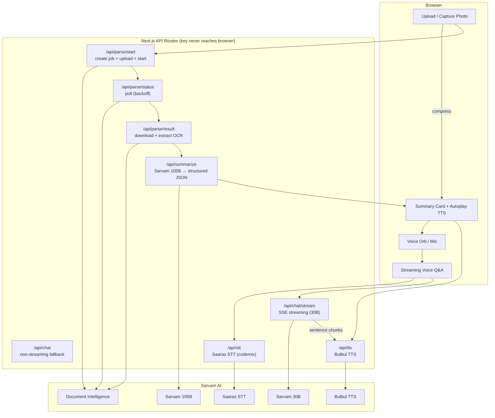

# KagazBol — Talk to any Indian document

> Photograph any Indian document — an electricity bill, a doctor's prescription, a bank notice,
> a government form — and have a natural voice conversation about it in Hindi, Marathi, or English.

## The problem

Hundreds of millions of Indians — parents, grandparents, first-generation digital users — regularly
receive documents they can't comfortably read: electricity bills full of English jargon, prescriptions
in cramped handwriting-turned-print, bank notices buried in officialese. Someone in the family usually
ends up reading it aloud and explaining it, often over the phone.

KagazBol turns that moment into a self-serve experience. Take a photo, hear a two-line summary in your
language, and ask follow-up questions out loud — "kitna bharna hai aur kab tak?" — and get an answer
spoken back, grounded only in *your* document.

## How it works

1. **Upload/capture** a photo of a document (or pick a bundled sample). Images are compressed
   client-side to ≤ 2,000 px before upload.
2. **Sarvam Document Intelligence (Vision)** OCRs the page — including Devanagari and mixed-script text.
3. **Sarvam 105B** turns the raw OCR text into a structured summary card: document type, key amounts,
   dates, deadline, and what action is required — in the user's chosen language.
4. **Sarvam Bulbul TTS** speaks a 2-line summary aloud immediately.
5. The user taps the mic (or speaks freely if auto-listen mode is on). **Sarvam Saaras STT**
   transcribes (code-mixed Hindi/Marathi/English), **Sarvam 30B** answers — grounded strictly in the
   document via a streaming pipeline — and **Bulbul TTS** speaks the reply sentence-by-sentence.
6. The user can interrupt (barge-in) at any time; the app stops speaking and starts listening.
7. A language switcher (English / हिंदी / मराठी) re-summarizes in the new language on the fly.

## Architecture



## Model routing

| Capability | Model | Why |
|---|---|---|
| Document OCR | **Sarvam Document Intelligence** | Reads Devanagari + mixed-script reliably |
| One-shot document summary | **Sarvam 105B** | Called once; accuracy on amounts/dates is worth the latency |
| Conversational follow-ups | **Sarvam 30B** | Called many times; tightly grounded prompt keeps it fast |
| Voice replies | **Bulbul v3 TTS** | Natural Hindi/Marathi/English voices |
| Voice questions | **Saaras v3 STT (codemix)** | Transcribes Hinglish/Marathi-English as people actually speak |

Both chat models are reasoning models — they emit a hidden `reasoning_content` step before the final
answer. `reasoning_effort: "low"` is sent to keep that step short. The streaming route (`/api/chat/stream`)
filters out `reasoning_content` entirely; the browser only sees final-answer content deltas.

## Quickstart

```bash
git clone https://github.com/Vedantd2003/kagazbol
cd kagazbol
cp .env.example .env   # add your SARVAM_API_KEY
npm install
npm run dev
```

Open [http://localhost:3000](http://localhost:3000).

### Verify your API key

```bash
npm run smoke-test
```

Hits chat completions (105B + 30B), TTS, STT, and the full Document Intelligence job flow.

## Scripts

| Script | Purpose |
|---|---|
| `npm run dev` | Start dev server |
| `npm run build` | Production build |
| `npm run lint` | ESLint |
| `npm run test` | Vitest unit tests |
| `npm run test:e2e` | Playwright e2e (requires `npx playwright install chromium`) |
| `npm run smoke-test` | Live API smoke test (requires SARVAM_API_KEY) |
| `npm run gen:fillers` | Generate filler audio files into public/audio/fillers/ (requires SARVAM_API_KEY) |
| `npm run bench:voice` | Measure streaming vs non-streaming voice latency, writes docs/VOICE_LATENCY.md |
| `npm run eval` | Run accuracy evaluation on eval/data/, writes docs/EVAL.md |

## Evaluation

See [docs/EVAL.md](docs/EVAL.md) for the evaluation framework.

Run `npm run eval` with real masked documents (see [eval/README.md](eval/README.md)) to populate the
results table. Synthetic samples in `eval/samples/` are scaffolding only and excluded from published
accuracy numbers.

## Voice latency benchmark

See [docs/VOICE_LATENCY.md](docs/VOICE_LATENCY.md).

Run `npm run bench:voice` with a valid `SARVAM_API_KEY` to measure streaming vs non-streaming
latency on your deployment. No numbers are hardcoded — the file is generated by the script.

## Deploying

### Render (primary — `render.yaml` already configured)

1. Connect the repo to Render.
2. Set `SARVAM_API_KEY` in the Render dashboard (not in render.yaml — never commit the key).
3. Push to main; Render builds and deploys automatically.

### Vercel (alternative)

- Set `SARVAM_API_KEY` as an environment variable in the Vercel project.
- The Hobby plan's 10 s per-invocation timeout is tight for the 105B summarize call; Pro (60 s) is safe.
- All routes use `runtime = "nodejs"` and are compatible with Vercel serverless.

## Design

See [docs/DESIGN.md](docs/DESIGN.md) for the full design rationale (Direction B: Indigo & Mist).

The UI targets elderly and first-generation digital users first:
- 18 px base font, 20 px for Devanagari
- ≥ 48 px touch targets (camera button is 72 px)
- Light and dark mode via `prefers-color-scheme`
- Animations respect `prefers-reduced-motion`
- WCAG AA contrast throughout

## Privacy

No database, no auth, no server-side document storage. Every document is processed in memory
for a single session and never persisted. The API key never reaches the browser.

## Project structure

```
src/
  app/
    page.tsx              # main UI orchestrator
    api/
      parse/start|status|result/  # OCR job lifecycle
      summarize/          # Sarvam 105B → structured summary
      chat/               # non-streaming fallback
      chat/stream/        # SSE streaming (Sarvam 30B)
      tts/                # Bulbul text-to-speech
      stt/                # Saaras speech-to-text
  components/             # UploadCard, SummaryCard, ChatPanel, VoiceOrb, ...
  hooks/                  # useAudioPlayer, useAudioRecorder, useVAD, useStreamingChat
  lib/
    sarvam/               # typed Sarvam API clients
    apiClient.ts          # browser-side fetch with AbortSignal + XHR progress
    compressImage.ts      # client-side canvas compression
    sentenceSplitter.ts   # Devanagari-aware sentence boundary detection
    fillerAudio.ts        # filler audio playback during reasoning
    prompts.ts            # LLM system prompts
    i18n.ts               # UI strings: en-IN / hi-IN / mr-IN
eval/
  schema/                 # JSON schema for eval labels
  samples/                # 3 synthetic sample documents (not used for accuracy)
  metrics.ts              # amount/date normalization, fuzzy matching
  run.ts                  # eval runner
scripts/
  smoke_test.ts           # live API smoke test
  gen-fillers.ts          # generate filler TTS audio files
  bench-voice.ts          # streaming vs non-streaming latency benchmark
docs/
  ANALYSIS.md             # Phase 0 architecture analysis and bug list
  DESIGN.md               # design directions and rationale
  EVAL.md                 # evaluation results template
  VOICE_LATENCY.md        # voice latency benchmark results
```
