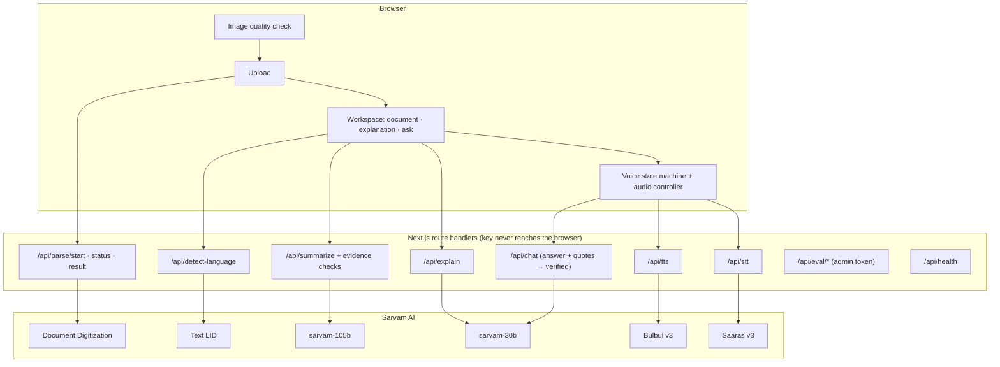

# KagazBol — Understand every document. In your language.

> Photograph an Indian document — an electricity bill, a prescription, a bank notice, a government
> form — and get a plain explanation in English, Hindi or Marathi. Ask follow-up questions by voice.
> Every amount and date is checked against the document before it's shown as fact.

## The problem

Hundreds of millions of Indians regularly receive documents they can't comfortably read: bills full
of English jargon, prescriptions, bank notices in officialese. Someone in the family usually ends up
reading it aloud over the phone. KagazBol makes that self-serve — and careful.

## What it does

1. **Upload or photograph** one page. Blurry, dark, tiny or sideways photos are flagged before upload.
2. **Sarvam Document Digitization** reads the text, including Devanagari and mixed-script pages.
3. **Sarvam 105B** writes a structured explanation in the chosen language: what it is, amounts, dates,
   the deadline, what to do, and any warnings in the document.
4. **Every amount and date is located in the document text.** Found values get a "Found in document"
   stamp and a *Show where* link that highlights the source line; anything not found is flagged.
5. **Ask by voice or text.** Saaras STT transcribes (Hinglish/Marathi-English is fine); you **confirm
   or edit what was heard** before it's sent. Sarvam 30B answers only from the document and cites
   verbatim quotes, which the server checks.
6. **Listen** with Bulbul TTS: pause, stop instantly, replay, seek, 0.75×–1.5×. Interrupt any time by
   pressing the mic. Or switch voice off entirely.
7. **Explain simply**: select any word or line in the document text for a plain-language explanation
   (with an example on request) that keeps warnings and numbers intact.
8. **Switch language** any time; explanations are cached per language.

KagazBol has **no accounts and no database**: documents are processed by Sarvam AI and live only in
the open browser tab. Only language/voice settings are stored, on the device.

## Architecture



Details: [docs/PIPELINE.md](docs/PIPELINE.md) (stages, errors, retries, provider verification),
[docs/VOICE.md](docs/VOICE.md) (state machine, playback, language policy),
[docs/EVAL.md](docs/EVAL.md) (metrics and modes), [docs/DESIGN.md](docs/DESIGN.md) (design system),
[docs/BASELINE.md](docs/BASELINE.md) (state of the code before this upgrade).

## Reliability dashboard

`/eval` (admin token) runs and compares evaluations: OCR CER/WER, extraction accuracy, evidence
coverage, answer accuracy and faithfulness, language detection, latency, failure analysis and cost
(only when real pricing is configured). A deterministic, free **checks** mode tests the verification
code against a labelled synthetic dataset with planted errors and runs in CI. Synthetic results are
always labelled as such.

## Quickstart

```bash
git clone https://github.com/Vedantd2003/kagazbol
cd kagazbol
cp .env.example .env   # add SARVAM_API_KEY (and optionally EVAL_ADMIN_TOKEN)
npm install --legacy-peer-deps
npm run dev
```

Open http://localhost:3000 (landing) or http://localhost:3000/app (the app).

## Scripts

| Script | Purpose |
|---|---|
| `npm run dev` / `build` / `start` | Develop / production build / serve |
| `npm run lint` | ESLint |
| `npm test` | Vitest: unit, API-route (mocked provider), component tests |
| `npm run test:e2e` | Playwright, desktop + phone, provider routes mocked, fake microphone |
| `npm run eval` | Checks-mode evaluation (free, deterministic) — `-- --live` for the real pipeline |
| `npm run smoke-test` | Live provider check (needs `SARVAM_API_KEY`) incl. Text LID and TTS field names |
| `npm run bench:voice` | Streaming vs non-streaming answer latency (needs key) |

Mocked tests prove the app's wiring and logic, not that the live provider behaves the same; use
`smoke-test` and `eval -- --live` for that.

## Deploying (Render)

`render.yaml` defines one web service (health check `/api/health`). Set `SARVAM_API_KEY` in the Render
dashboard; optionally `EVAL_ADMIN_TOKEN` (24+ chars) and `EVAL_PRICING_JSON`. For dashboard history
to survive restarts, attach a disk and set `EVAL_RESULTS_DIR`. Render deploys on push to `main`.

## Limitations

- Bounding boxes aren't available from the markdown OCR output, so evidence is located by text line.
  Migrating to Sarvam's newer `/doc-ai/v1` (JSON with boxes, PDF support) is the next step.
- One page per document; images only (no PDF yet).
- Rate limits and the evaluation job queue are per server instance (in memory).
- The faithfulness checker catches invented numbers and quotes; it can't prove an interpretation is
  right. KagazBol explains documents — it does not give medical, legal or financial advice.
